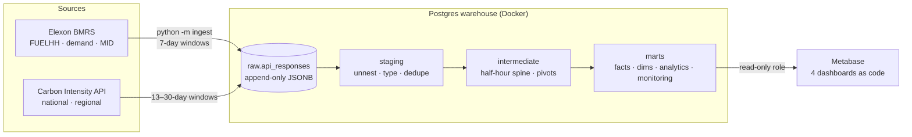

# Britain after coal

**An end-to-end analytics engineering project on Great Britain's electricity grid, 2017 → today.**

Britain's last coal power station, Ratcliffe-on-Soar, closed on 30 September 2024. This project
pulls every half hour of grid data since 2017 from two public APIs and models it with dbt in
Postgres. It then serves four Metabase dashboards that answer:

1. **What replaced coal**, and how much cleaner is the grid?
2. **How does wind affect the wholesale price** of electricity?
3. **When is the cleanest time to charge an EV**, region by region?
4. **Can the numbers be trusted?** A data quality dashboard tracks completeness and known upstream issues.

| | |
|---|---|
| **Data** | Elexon BMRS Insights API (generation by fuel, demand, market price) and the National Grid ESO Carbon Intensity API (national and 14 regional areas). Both are public and need no key. |
| **Volume** | ~3.9 million source records from ~2,000 API requests; 171k half hours; 2.6 million regional half-hour rows |
| **Stack** | Python ingestion → Postgres 16 (Docker) → dbt-core 1.12 + dbt-utils → Metabase 0.63, with dashboards as code |
| **Tests** | 46 dbt tests across 19 models: unique/not-null/relationship/range tests, clock-change and timezone tests, warn-level monitoring of known upstream issues and completeness |
| **Write-up** | [Technical article](docs/article.md), with dashboard screenshots in [`docs/images/`](docs/images/) |

---

## Findings

| | 2017 | Last 12 months |
|---|---|---|
| Coal share of supply | 7.6% | **0%** |
| Wind share of supply | 11.9% | **~32%** |
| Average grid carbon intensity | 288 g/kWh | **~123 g/kWh** |
| Coal-free days | 3 | **360 of 365** |

- **Wind, not gas, replaced coal.** From 2017 to 2019 coal fell by ~15 TWh, wind rose by ~14 TWh, and gas barely moved.
- **Wind lowers the price, a lot.** In 2025, half hours when wind supplied more than 60% of supply averaged **£15/MWh**, against **£105/MWh** when it supplied under 10%.
- **2022 was the exception.** Gas prices pushed the average wholesale price to ~£198/MWh, and Britain became a **net exporter** while much of France's nuclear fleet was offline.
- **The cleanest time to charge has moved from midnight to midday.** For Britain as a whole, the cleanest hour was 00:00 in 2019 (182 g/kWh) and 12:00 in 2025 (112 g/kWh), as solar grew.
- **It also depends on where you live.** Scotland stays under ~25 g/kWh around the clock. South Wales averages ~190 g/kWh even at its cleanest hour.

---

## Architecture



**Ingestion** (`ingest/`): a small, idempotent loader. Each API request window lands as one row in
`raw.api_responses`, with the response body **untouched** in JSONB, plus the URL, HTTP status,
record count and fetch time. The table is append-only, so re-fetches never overwrite history.
Windows already loaded are skipped, and the last 7 days are always re-fetched to pick up Elexon
revisions. A full backfill is ~2,000 requests and takes about 25 minutes.

**Modelling** (`dbt/`):

| Layer | What happens |
|---|---|
| `staging` | Unnest JSON arrays (two levels deep for regional data), cast types, and **deduplicate** overlapping windows and revisions (latest `publishTime`, then latest fetch wins). The two largest models are **incremental**: they only unnest responses not processed yet. |
| `intermediate` | `int_half_hours`: a half-hour spine in UTC **and** Europe/London time, with GB settlement date and period. `int_generation_pivoted`: fuel types pivoted to fuel groups from a seed. |
| `marts/core` | `fct_grid_half_hourly` (the one wide, analysis-ready table), `fct_generation_by_fuel`, `fct_regional_carbon_intensity`, plus `dim_date`, `dim_fuel_type` and `dim_region` |
| `marts/analytics` | `mart_grid_daily`, `mart_price_by_wind_share`, `mart_charging_windows` |
| `marts/monitoring` | `mart_data_quality_daily` (completeness per source per day) and `mart_ingestion_log` |

**Serving**: Metabase connects as `metabase_reader`, which can read the `marts` schema and
nothing else. dbt grants are declared in `dbt_project.yml`. The dashboards live in
[`metabase/dashboards.yml`](metabase/dashboards.yml) and are deployed by
[`metabase/deploy.py`](metabase/deploy.py), which updates existing questions in place.

---

## Data quality: what the tests caught

Most of the engineering effort went here. Each of these was found by a dbt test and then
**verified against the data** before it was handled:

| Finding | How it was handled |
|---|---|
| **Elexon labels the last half hour of each day with the wrong date** (period 48, or 46/50 on clock-change days) before 15 Jul 2022: 1,921 half hours. Its `startTime` field is right. | Proved by comparing each period with its neighbours under both readings: the `startTime` reading fits ~10× better (gas: 426 MW vs 2,434 MW error). Settlement date and period are now **derived from `startTime`**, the published labels are kept for audit, and a warn-level test alerts if the count grows. |
| **Clock-change days** have 46 or 50 settlement periods, not 48 | The spine is built in Europe/London time. A singular test checks every last Sunday of March and October, using a rule that doesn't rely on the timezone database. |
| Elexon published ElecLink as **`INTELE`** instead of `INTELEC` on 10 Sep 2021 | Mapped in staging. A `relationships` test against the `fuel_types` seed fails on any new, unknown fuel code (for example a new interconnector). |
| Carbon Intensity **forecasts of ~2,800 g/kWh** (Dec 2018; the actual was ~170) | Nulled in staging and flagged, with the raw value kept. A range test enforces 0–1,000. |
| The **N2EX** market index has zero traded volume throughout | Excluded; the APX price is used. The excluded row count is reported on the data quality dashboard. |
| **"Ghost" coal readings** after the last coal plant closed: 8 isolated half hours, all period 21 (10:00–10:30) on a Wednesday | Kept as published (under 0.01% of supply), and a warn-level test lists them. They look like a metering or test artefact, which can't be confirmed from the data. |
| Real **upstream gaps** (e.g. missing demand data on 21 days in 2017–2021) | Not hidden. Shown per day on the data quality dashboard, with a warn-level completeness test. |

---

## Run it yourself

Requirements: Docker, Python 3.11+, `make`.

```bash
cp .env.example .env              # then set your own passwords
make up                           # start the Postgres warehouse on localhost:5433
make setup                        # virtualenv, dbt-postgres, dbt packages
make ingest                       # backfill 2017 → today (~25 min); re-run any time for new data
make build                        # dbt seed + run + test
make docs                         # dbt docs and lineage graph on http://localhost:8080
```

Dashboards:

```bash
docker compose --profile metabase up -d   # fresh Metabase on http://localhost:3001 (or use your own)
# In Metabase: add a PostgreSQL database named "GB Grid warehouse"
#   host: warehouse (or host.docker.internal), port 5432/5433, db: grid,
#   user: metabase_reader, schemas: only "marts"
# Then create an API key (Admin → Settings → Authentication → API keys) and run:
MB_URL=http://localhost:3001 MB_API_KEY=... .venv/bin/python metabase/deploy.py
```

## Repository layout

```
ingest/                 Python loader → raw.api_responses
warehouse/init/         schemas and the read-only Metabase role
dbt/
  models/staging/       one model per API dataset
  models/intermediate/  half-hour spine, pivots
  models/marts/         core facts and dims, analytics marts, monitoring
  seeds/                fuel types, regions, key grid events
  tests/                singular tests (clock changes, alignment, completeness)
  macros/               settlement period maths, JSON unnesting
metabase/               dashboards.yml + deploy.py
```

## Notes and limitations

- Elexon FUELHH covers **transmission-metered** generation only. Rooftop and other embedded
  solar is not in the TWh figures. The Carbon Intensity generation mix (`mix_*_pct` columns)
  does estimate it.
- "Net imports" is the sum of all interconnector flows. It is negative when Britain exports.
- Regional figures are Carbon Intensity **forecasts**. The API does not publish regional actuals.

