# Britain after coal

### Modelling nine years of half-hourly grid data with dbt, Postgres and Metabase, and the timestamp bug my tests found in the official data

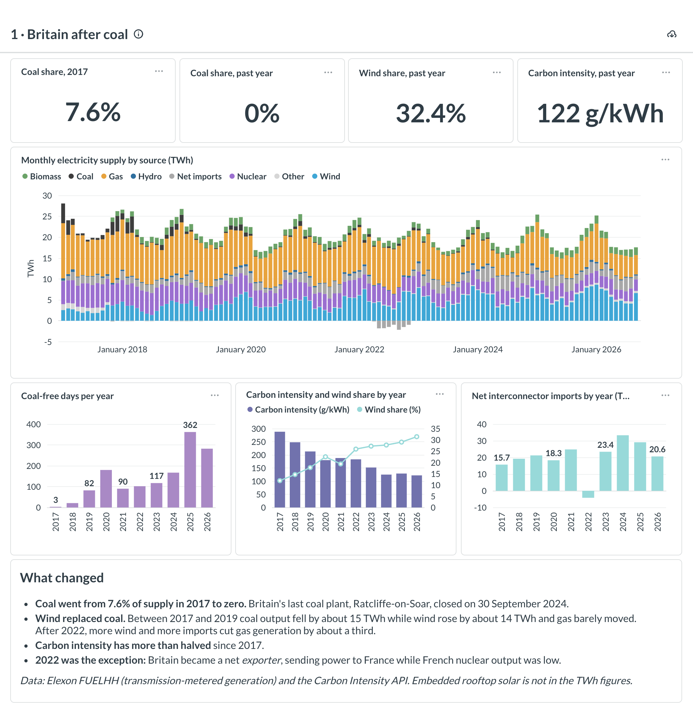

On 30 September 2024, Ratcliffe-on-Soar power station in Nottinghamshire burned its last coal. It was
the last coal plant in Britain, the country that started burning coal for electricity in 1882.

I wanted to see the transition in the data, half hour by half hour, so I built a small but complete
analytics stack around it. Two public APIs feed a Postgres warehouse, dbt turns the raw responses into
tested models, and Metabase serves four dashboards that are defined as code.

This article covers how it's built, the data problems the tests caught (including one in the
official settlement data), and what the numbers say.

**TL;DR**

- **Coal went from 7.6% of supply in 2017 to effectively zero.** Wind went from 11.9% to 32.4%, and the
  grid's average carbon intensity fell from 288 to 122 gCO₂/kWh.
- **Wind, not gas, replaced coal.** From 2017 to 2019 coal output fell by about 15 TWh, wind rose by about 14 TWh,
  and gas barely moved.
- **Windy half hours are dramatically cheaper.** In 2025, when wind supplied more than 60% of supply,
  the wholesale price averaged **£15/MWh**. When wind supplied less than 10%, it averaged **£105/MWh**.
- **The cleanest time to charge an electric car moved from midnight to midday.** For Britain as a
  whole, the cleanest hour was 00:00 in 2019 and 12:00 in 2025.
- **One of the data sources dates the last half hour of each day a day late** in its older records
  (1,921 cases). The dbt tests flagged it, and comparing each half hour with its neighbours proved
  which field was wrong.

**Stack:** Python · Postgres 16 (Docker) · dbt-core 1.12 + dbt-utils · Metabase 0.63 · about 3.9 million
source records · 19 models · 46 tests.

---

## The data: two publishers, two clocks

| Source | What it gives you | History | Request limit |
|---|---|---|---|
| **Elexon BMRS** (`FUELHH`) | Average MW per fuel type per half hour, including 10 individual interconnectors | Jan 2017 → | 7 days |
| **Elexon BMRS** (Market Index) | Short-term wholesale price (£/MWh) and traded volume | Jan 2017 → | 7 days |
| **Elexon BMRS** (demand outturn) | National and transmission demand (MW) | Jan 2017 → | 7 days |
| **Carbon Intensity API** (national) | Forecast and actual gCO₂/kWh, plus generation mix % | Sep 2017 → | 31 days |
| **Carbon Intensity API** (regional) | Forecast intensity and mix for 14 regions plus nations | May 2018 → | under 14 days |

Both are public and need no key. The interesting part is that they use **different clocks**:

- **Elexon** reports in *settlement periods*: half-hour slots numbered from 1 at **local midnight**.
  A normal day has 48 periods. When the clocks go forward in March the day has **46**, and when they go back in October
  it has **50**.
- **Carbon Intensity** reports in **UTC** timestamps.

Joining the two correctly is the core modelling problem, and it's where the bugs were.

---

## Architecture

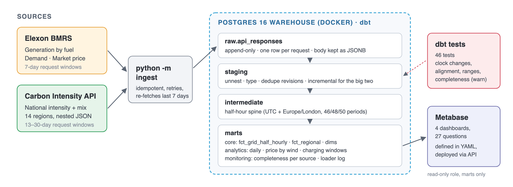

### 1. Ingestion: land the response, change nothing

The loader (`python -m ingest`) is deliberately simple. It splits the requested date range into
windows that fit each API's limit and calls the API for each window. It writes **one row per request**
to a single table, with the response body stored untouched:

```sql
CREATE TABLE raw.api_responses (
    response_id   bigserial PRIMARY KEY,
    source        text        NOT NULL,   -- e.g. 'elexon_fuelhh'
    window_start  date        NOT NULL,
    window_end    date        NOT NULL,
    request_url   text        NOT NULL,
    http_status   int         NOT NULL,
    record_count  int,
    fetched_at    timestamptz NOT NULL DEFAULT now(),
    payload       jsonb                   -- the response exactly as received
);
```

Three decisions here matter later:

- **Append-only.** A re-fetch adds a new row and never overwrites one. If a publisher revises a number,
  both versions are kept, and the models decide which one wins.
- **Idempotent windows.** Windows that already loaded successfully are skipped, except the **last 7 days**,
  which are always re-fetched to pick up late revisions. Running it twice is harmless.
- **No parsing in Python.** The loader doesn't know what a fuel type is. All typing, unnesting and
  deduplication happens in SQL, in dbt, where it's tested and documented.

The full backfill from 2017 is 2,075 requests (3.9 million records) and takes about 25 minutes, with
4 worker threads, retries and exponential backoff. It finished with zero failed requests.

### 2. Staging: unnest, type, deduplicate

Every staging model starts from the same macro, which unnests the `data` array of each successful
response. On incremental runs it reads only responses the model hasn't processed yet:

```sql

    select r.response_id, r.fetched_at, rec
    from {{ source('raw', 'api_responses') }} as r
    cross join lateral jsonb_array_elements(r.payload -> 'data') as rec
    where r.source = '{{ source_name }}'
      and r.http_status = 200
    
      and r.response_id > (select coalesce(max(source_response_id), 0) from {{ this }})
    

```

Overlapping windows and re-fetches mean the same half hour can appear several times, so each model keeps
the **latest published** version (ranked by `publishTime`, then by fetch time). The regional model
unnests two levels: every record has a `regions` array, and every region has a `generationmix` array.
The two largest models (2.9 million generation rows and 2.6 million regional rows) are **incremental**,
using `delete+insert` on their natural keys.

### 3. The half-hour spine

Everything joins to one model, `int_half_hours`: one row per half hour since 2017. Each row has the UTC
start time, the local time, and the GB settlement date and period. The settlement maths is a macro, so
there's exactly one definition of it:

```sql

    (1 + floor(extract(epoch from
        ({{ ts }}) - ((({{ ts }}) at time zone 'Europe/London')::date::timestamp at time zone 'Europe/London')
    ) / 1800))::int

```

In words: take the local date, find the UTC instant of that date's local midnight, and count the
half hours elapsed since then. Because it counts elapsed time rather than wall-clock time, it gives 46
periods on spring-forward days and 50 on fall-back days without special cases.

Of course, "without special cases" is what you say right before the special case bites, so there's a
test for it.

---

## What the tests found

The first `dbt build` failed four tests. One of them was my own bug. The other three were problems in the
source data.

### The bug in my test

The clock-change test checks every day against an *independent* rule ("the last Sunday of March has 46
periods, the last Sunday of October has 50"), deliberately not using the timezone database:

```sql
case
    when extract(month from settlement_date) = 3 and extract(isodow from settlement_date) = 7
         and settlement_date + 7 >= (date_trunc('month', settlement_date) + interval '1 month')::date then 46
    when extract(month from settlement_date) = 10 and extract(isodow from settlement_date) = 7
         and settlement_date + 7 >= (date_trunc('month', settlement_date) + interval '1 month')::date then 50
    else 48
end as expected_periods
```

The first version had `>` instead of `>=`, so it missed 25 March 2018 and 25 October 2020: Sundays
exactly seven days before the end of the month. The spine was right and the test was wrong. A failing
test means *something* is wrong, not necessarily the model.

### The real one: Elexon's last half hour of the day

The second failure was more interesting. A test checks that every Elexon row lands on the spine at the
same instant. **1,890 rows didn't**, all of them **settlement period 48**, all before July 2022. In each
case Elexon's `startTime` was exactly **one day earlier** than the settlement date and period implied.

```
 settlement_date | period | elexon startTime       | implied by date + period
 2017-01-01      |   48   | 2016-12-31 23:30 UTC   | 2017-01-01 23:30 UTC
 2017-01-02      |   48   | 2017-01-01 23:30 UTC   | 2017-01-02 23:30 UTC
```

One of Elexon's two fields is wrong. Either the `startTime` is a day early, or the `settlementDate`
label is a day late. My first assumption was that the timestamp was wrong, so I derived the time from
the date and period and moved on.

**That assumption was wrong**, and I only found out because I tested it. If the label is correct, the
value in "period 48 of day D" should sit between period 47 of day D and period 1 of day D+1. If the
`startTime` is correct, it should sit between period 47 of day D−1 and period 1 of day D. So I
interpolated both ways and measured the error:

```sql
select fuel,
       avg(abs(p48 - (p47_same_day + p1_next_day) / 2)) as error_if_label_correct,
       avg(abs(p48 - (p47_prev_day + p1_same_day) / 2)) as error_if_starttime_correct
...
```

| Fuel | Error if the label is correct | Error if `startTime` is correct |
|---|---|---|
| Gas (CCGT) | 2,434 MW | **426 MW** |
| Wind | 2,176 MW | **178 MW** |
| Nuclear | 128 MW | **14 MW** |

That's not close: **the `startTime` is right and the settlement date label is a day late.** The fix:

1. Derive `settlement_date` and `settlement_period` **from `startTime`** in all three Elexon staging
   models, using the same macros as the spine.
2. Keep the published values as `settlement_date_as_published` and `settlement_period_as_published`,
   so the correction can be audited.
3. Turn the check into a **warn-level test with a threshold**. The known issue is 1,921 half hours (it
   also hits period 46 or 50 on clock-change days), so the test warns only if the count grows.

```sql
{{ config(severity='warn', warn_if='>1922') }}

select distinct half_hour_start_utc, settlement_date, settlement_period,
       settlement_date_as_published, settlement_period_as_published
from {{ ref('stg_elexon__generation_by_fuel') }}
where (settlement_date, settlement_period) <> (settlement_date_as_published, settlement_period_as_published)
```

This is the part of the project I'd talk about in an interview. The test didn't tell me the answer: it
told me there was a question. The answer came from checking the data against what I'd assumed.

### The smaller ones

| What the tests caught | How it's handled |
|---|---|
| ElecLink appears as **`INTELE`** instead of `INTELEC` on one day (10 Sep 2021, 9 rows) | Mapped in staging. A `relationships` test against the fuel-type seed fails on any **new** unknown code, which is how a new interconnector would show up. |
| A run of Carbon Intensity **forecasts of ~2,800 gCO₂/kWh** in Dec 2018, while the actual was ~170 | Nulled in staging and flagged, with the raw value kept. A range test enforces 0–1,000. |
| The **N2EX** market index reports a price of 0 with **zero volume**, for every period | Excluded; the APX price is used. The excluded count (168,422 rows) is shown on the data quality dashboard. |
| **"Ghost" coal**: 8 isolated half hours of coal generation *after* the last coal plant closed | All 8 are settlement period 21 (10:00–10:30) on a Wednesday, a couple of months apart. That looks like a metering or test artefact, but I can't confirm it from the data. Kept as published (well under 0.01% of supply) and listed by a warn-level test, so the dashboard says "effectively zero" rather than hiding it. |
| Real **gaps** in the sources, e.g. 21 days of missing demand data in 2017–2021 | Not hidden. A completeness mart counts each source against the expected 46/48/50 periods per day. |

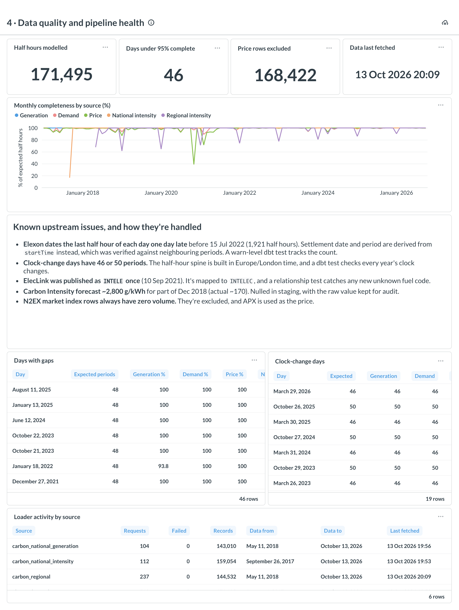

The data quality dashboard is built from two monitoring marts. `mart_data_quality_daily` compares
every source against the expected number of periods for that day. `mart_ingestion_log` summarises the raw
table, showing what was fetched, when, and how many requests failed. Completeness is a warn-level test
too: a gap at the source shouldn't fail the build, but it shouldn't go unnoticed either.

---

## The marts

The models are layered on purpose:

- **`fct_grid_half_hourly`**: one wide row per half hour, with generation by fuel group, demand, APX
  price, national intensity and the Carbon Intensity mix. Most dashboard questions are a `GROUP BY` on
  this one table, which keeps Metabase SQL short and readable.
- **`fct_generation_by_fuel`** and **`fct_regional_carbon_intensity`**: the long, narrow facts, for
  when you need a single fuel or a single region.
- **`dim_date`**, **`dim_fuel_type`** and **`dim_region`**, the last two built from seeds. The fuel-type
  seed is what turns 20 Elexon codes into fuel groups, and it flags interconnectors, fossil fuels and
  low-carbon sources.
- **Analytics marts:** daily energy and shares, price by wind share band, and cleanest charging hour by
  region and month.

One modelling note matters for every number below. **Elexon only sees plant connected to the
transmission network.** Rooftop and other small solar isn't in the TWh figures. The Carbon Intensity mix
does estimate it, so both are kept, in clearly separated columns (`*_mw` vs `mix_*_pct`).

---

## Dashboards as code

The four dashboards aren't clicked together. They live in `metabase/dashboards.yml`, with native SQL,
visualisation settings, layout and filters:

```yaml
- name: Average price by wind share of supply
  display: bar
  layout: [0, 0, 12, 7]          # col, row, width, height on Metabase's 24-column grid
  params: {year: year}           # wired to the dashboard's Year filter
  sql: |
    select wind_share_band, avg_price_gbp_per_mwh, half_hours
    from marts.mart_price_by_wind_share
    where year = {{year}}
    order by wind_share_band_start_pct
  tags: {year: {type: number, default: "2025", required: true}}
```

`metabase/deploy.py` turns that into Metabase API calls. It updates existing questions in place
(matched by name), then replaces each dashboard's layout. Metabase connects as `metabase_reader`, a role
that can read the `marts` schema and nothing else. The screenshots in this article come from
`metabase/screenshots.py`, which drives headless Chrome over the DevTools protocol, waits for every query
to finish, and crops each chart.

---

## What the data says

### Wind replaced coal, then pushed gas down

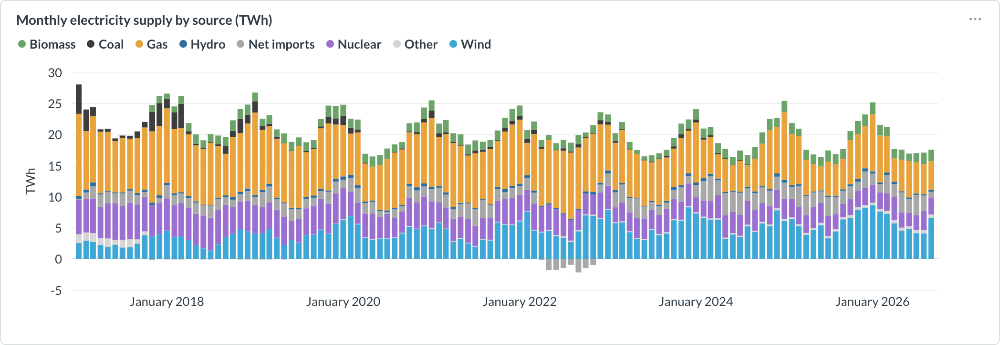

Coal (dark grey) is visible in every winter until 2019, then shrinks to a sliver and disappears after
September 2024. Between 2017 and 2019, coal fell by about 15 TWh and wind rose by about 14 TWh, while gas
barely moved (119 → 114 TWh). The second phase came later: from 2022 to 2024, gas fell from 111 to 73
TWh as wind kept growing and imports returned.

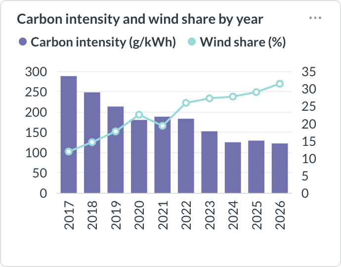

2022 is the year the pattern breaks. Gas prices pushed the average wholesale price to **£198/MWh** (the
monthly peak was £353 in August), and Britain was a **net exporter** for the year (−4.2 TWh), sending
power to France while much of the French nuclear fleet was offline.

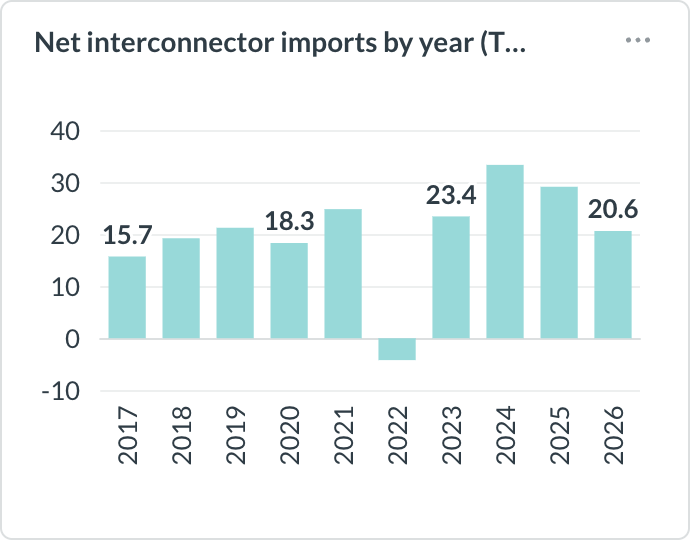

### Windy half hours are cheap, and sometimes negative

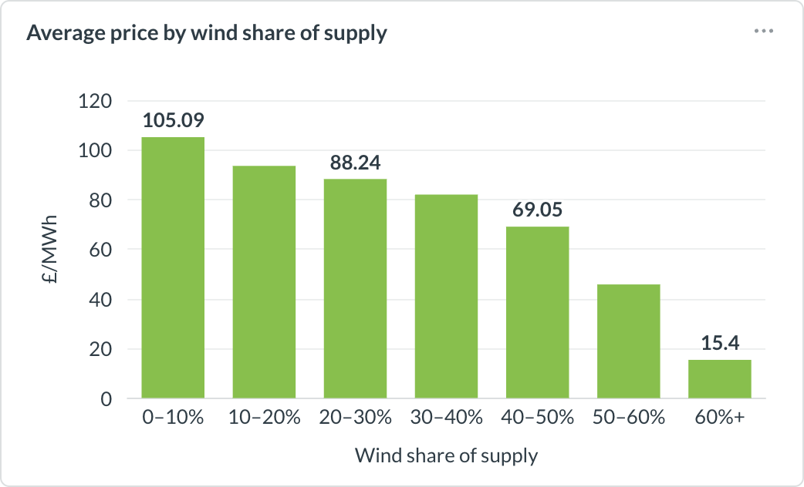

Grouping every 2025 half hour by how much of supply came from wind gives a clean staircase: **£105/MWh**
when wind is under 10%, falling to **£15/MWh** above 60%. When the wind blows, gas plants are needed less,
and gas usually sets the price.

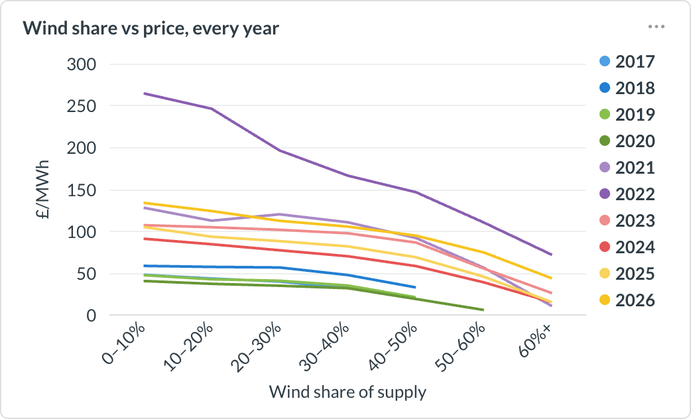

Every year shows the same downward slope at a different level, with 2022 far above the rest. The extreme
end is negative prices, where generators pay to keep running. That happened in 41 half hours in 2017 and
**495 in 2024**.

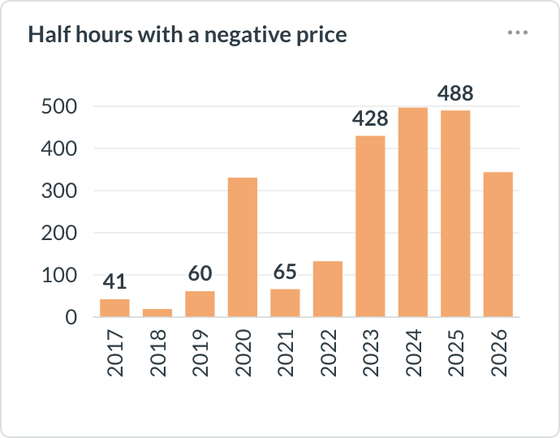

### The cleanest time to charge moved from midnight to midday

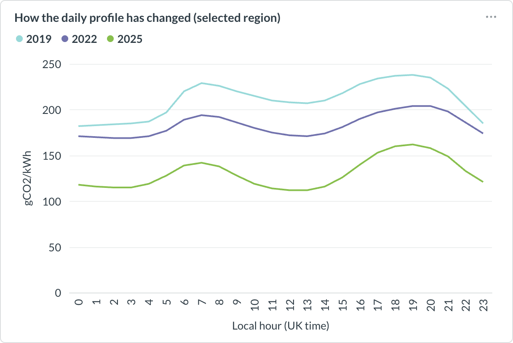

In 2019 Britain's cleanest hour was **midnight** (182 g/kWh), when demand is low. By 2025 it was **noon**
(112 g/kWh): the whole curve dropped, and a solar-shaped dip opened up in the middle of the day.

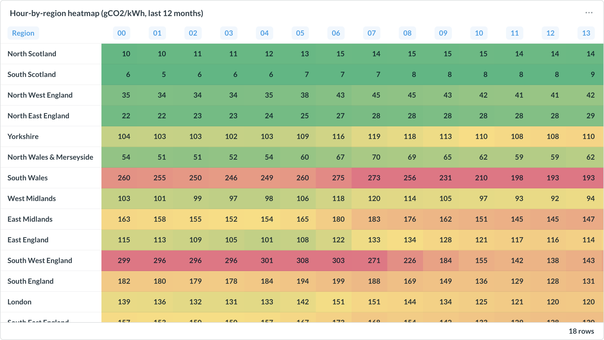

Where you live matters more than when you plug in. Scotland stays under ~25 g/kWh around the clock. South
Wales averages ~190 even at its cleanest hour. South West England swings the most: **317 g/kWh at
21:00** but **138 at noon** over the last 12 months, a 56% difference that comes from solar.

---

## What I'd tell someone building something similar

1. **Land raw responses untouched, and append-only.** Every bug in this article was diagnosed by going
   back to the exact payload and the time it was fetched. If the loader had parsed and overwritten, there'd
   be nothing to go back to.
2. **Build the time spine first, and test it against an independent rule.** Time zones and clock
   changes are where analytics quietly goes wrong.
3. **When a test fails, test your assumption about *why*.** My first fix for the Elexon issue was
   backwards. Comparing each period with its neighbours took ten minutes and settled it.
4. **Use warn-level tests with thresholds for known upstream issues.** Failing the build on a
   publisher's historical quirk is noise. Never noticing if it gets worse is a blind spot. `warn_if='>N'`
   sits in between.
5. **Make data quality a dashboard, not just a log.** The completeness view is the first thing I'd show
   a stakeholder who asks "can we trust this?"

## Run it yourself

```bash
git clone https://github.com/YOUR-USERNAME/gb-grid-after-coal && cd gb-grid-after-coal
cp .env.example .env      # set your own passwords
make up setup ingest build
```

The README has the Metabase steps and the full model list.

*Data © Elexon Limited and National Grid ESO, used under their open data terms.*
